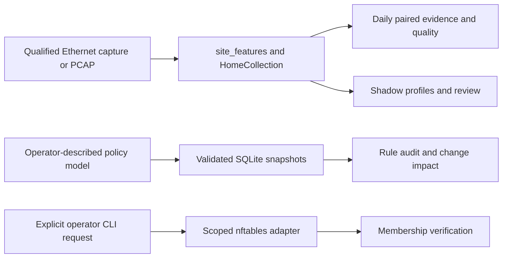

The product goal is a closed evidence/decision/action/verification loop. Today the paths below are separate, deliberately testable foundations. They must not be drawn as an already automatic firewall reconfiguration service.

home_sensor.py orchestrates site_features.py, collection_io.py and site_policy.py. It writes UNKNOWN-labeled observations, descriptive profiles and shadow evidence. http_dashboard.py supplies only read-only UI/docs/JSON transport. It no longer imports the legacy passive runner or its RF/AE modules merely to serve the dashboard.

policy_inventory.py drives firewall_policy.py, policy_store.py, policy_audit.py and policy_change.py; policy_http.py exposes their read-only viewer. Inputs are operator-described models, not native vendor policy exports. Header-model outcomes are not route/NAT reachability proofs. nft_quarantine.py is separate and operator-run.

## Retained thesis reference path

Controller_main_Claude.py still provides OpenFlow PacketIn/DAI and Snort callbacks; traffic_capture.py constructs the original 102-column flow/device/network rows, rate hysteresis and RF/AE scoring. passive_ids.py reuses those features without Ryu and only observes. site-v3 has a different 71-column contract.

The Ryu flush/Snort OS threads enqueue action requests for a hub worker; they must not call datapath.send_msg directly. Submitted state/banner counts are not independent switch acknowledgments or containment proof. These original paths remain lab references under [repository scope](/developers/repository-scope), not prerequisites for collecting current site data.

The behavioral bridge to policy revisions, calibrated action confidence, native adapters, durable transactions/read-back/rollback and guarded online promotion remain [phased work](/roadmap/delivery-phases). Preserve all [feature groups](/architecture/feature-rationale) and their observation/quality evidence when building that bridge.
