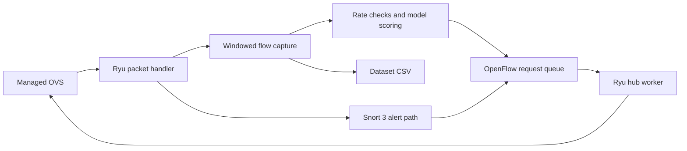

The Ryu packet handler parses Ethernet and available protocol headers and passes observations to the collector. The unidirectional key is source IP, destination IP, destination port and protocol. The flush worker builds rows from approximately five-second windows. Features cover packet size, timing, protocol flags, reverse traffic, destination diversity and device context. The normal schema is selected through `IPS_V2_FEATURES`.

The flush thread and Snort monitor can submit mitigation requests. The hub worker sends OpenFlow messages. Known MAC enforcement uses a source MAC match, and the REST fallback uses an IPv4 source match. The opt-in host firewall handles selected host-plane alerts separately.

The scoring cap defaults to 60 rows per window and favors higher packet rates. Low-rate flows may be recorded without model inference. Per-device statistics can adapt, while RF and AE weights stay fixed. An AE anomaly is a deviation signal, with no proof of compromise.
