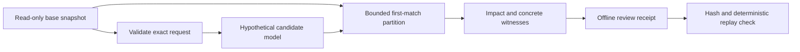

Read [the offline runbook](/deployment/offline-policy-changes) for commands and [the feature rationale](/architecture/feature-rationale) for scientific assumptions. This milestone adds preparation for P8/P12 and source-mapped P2 evidence without needing a live mirror. The home collector, deployed model artifacts and firewall enforcement paths are unchanged.

## Data flow and authority

There is no apply edge. A receipt is not a native configuration, authorization, signature or installation result. Even a verified supported-header equivalence does not represent routes, NAT, state, applications, security profiles or business approval. The original snapshot is deep-copied, and all store connections for impact/proposal/verification stay read-only.

## Controller/policy_change.py

| Source lines / anchor | Rationale |
| --- | --- |
| Imports, MAX_REGIONS, ENGINE_MANIFEST and SCOPE | Use the existing strict header model and bounded region algebra. Capture Python/source hashes when the module loads, not a later file read that could describe a different checkout. These hashes are reproducibility metadata; restart after source updates and do not call them remote code attestation. |
| 22–27, EffectiveRegion | Attach a supported box to known action/logging and decisive rule, or to an uncertainty source. Unknown membership is distinct from a definite deny/permit. |
| 30–37, universe | Construct six disjoint family/protocol cases: TCP/UDP and appropriate ICMP for IPv4/IPv6, with bounded integer address/port intervals. Other IP protocols are deliberately outside this proof domain. |
| 40–49, overlaps | Intersect all relevant dimensions using shared budget accounting and a region cap. Same ports in different source/destination/family spaces are not automatically the same traffic. |
| 52–58, possible_envelope | For unresolved sources/destinations, broaden only an internal possible-match bound and strip unsupported constraints solely for that bound. This never turns an unresolved object into a proven ANY permit. Remaining known header fields constrain where uncertainty matters. |
| 61–90, effective_regions | Process enabled rules in order against residual universe space. Exact known matches get definite outcomes. Potential earlier unknown matches occupy an unknown region, preventing a later rule from manufacturing certainty there. Subtract chosen/possible regions, then use the explicit default for remaining space. Global unknown context makes all supported space unknown. |
| 93–97, outcome | Serialize action, logging, rule/default and uncertainty separately for an inspectable witness. Default access may be known while default logging remains unspecified. |
| 100–163, impact | Normalize both models, enforce scope identity, partition them and compare intersecting effective regions. Detect expansions/restrictions, deny-versus-reject changes, explicit logging differences and rule attribution changes. Count unknown access/logging separately; full analysis is independent of display limit. Keep a first witness per category even when the example list is truncated. |
| 166–224, proposal | Require exact fields, a matching base SHA-256, bounded reason and 1–16 supported operations. Copy the model, apply one operation per targeted rule, validate move anchors and produce a deterministic hypothetical revision. Renumber only hypothetical move positions. Evaluate impact before returning the candidate/receipt; do not mutate/import the original. |
| 227–243, verify_proposal | Validate the receipt hash, replay its request against the supplied base and compare canonical entire results. Rehashed but inconsistent action/state/candidate data fails replay. Changed engine/Python fingerprints require regeneration/review. Hashes do not authenticate the operator. |

The box representation and set subtraction are reusable choices for this subset. Essential invariants are first-match semantics, same-context inputs, exact before/after lineage, bounded resource work, preserved uncertainty and no write authority. A future native adapter must represent additional predicates instead of silently dropping them.

Unknown action and unknown logging have different consequences. Access can be equivalent while logging remains indeterminate. Default logging is not represented by apf-policy-v1; neither an empty log nor a same default action proves logging equivalence. A change from deny to reject also matters and is not collapsed into a generic block. A change in decisive rule can affect attribution even when action/logging agree.

Counters describe symbolic partitions. They are not hit counts, packet counts or risk percentages; splitting a CIDR can change partition count without changing exposure. A concrete witness proves a model-space difference under the stated assumptions. Its address may be unassigned, and the checker never probes it.

The uncertainty strategy is conservative. It may decline equivalence even when an unchanged unsupported rule would have unchanged real behavior. This is preferable to asserting a proof whose required predicate is absent. An independently supported change elsewhere still has a witness and known_access_change_present true. Budgets abort before a complete result is returned, rather than publishing a partial proof as equivalent.

## CLI, API and browser

scripts/policy_inventory.py adds impact, propose and verify-proposal. Requests use strict duplicate-key/size-bounded JSON parsing. Only propose with an explicit --output creates a private new receipt file, mode 0600 on Unix; O_EXCL prevents replacement. Receipt size is checked against its verification input cap before writing. Disk failure can leave an incomplete new file, so successful generation and subsequent verification are required; no filesystem step is claimed to be a firewall transaction. The database stays read-only for all three operations.

Controller/policy_http.py adds GET /policy/impact and GET /policy/preview. The existing argument validator rejects unknown/repeated fields and routes numeric limits into the same code as the CLI. Preview constructs a fixed-rationale one-operation request in memory. It neither imports the candidate nor writes a receipt file. The viewer adds an impact button and an explicitly offline preview form. URLSearchParams encodes values and textContent renders returned data. There is no HTTP apply/delete/native-write endpoint.

The loopback/SSH trust boundary is unchanged. A production service still needs authenticated roles/tenant isolation, bounded request concurrency/rates, secret management and vendor qualification. Neither site labels nor a local receipt establish SOC authorization.

## Source-mapped feature rationale guard

docs-site/reference/feature-groups.json contains G1–G24 and six supporting categories: BASE, DEVICE, NETWORK, LABELS, QUALITY and POLICY. Each has an explicit status/model-use classification, current column ownership per schema and an exact rationale heading. Planned groups have no implemented columns; G10 and LABELS are marked excluded from predictor use. This is a documentation/input-contract classification, not proof that every historical trained artifact already obeys it.

scripts/check_feature_catalog.py uses standard-library AST parsing rather than importing Ryu, Scapy or model loaders:

| Anchor | Why it exists |
| --- | --- |
| source_columns | Read literal legacy column lists, site metadata and explicit FeatureHistory result keywords. Dynamic/changed definition shapes fail and require a deliberate checker update; arbitrary source code is not executed. |
| validate | Require all numbered/supporting groups exactly once, valid current/planned statuses, exact headings with substantive explanation and one owner for every source column. Reject invented/missing/duplicate mappings and planned implementation claims. Keep labels/audit metadata excluded in the catalog. |
| main / --staged | Use fixed repository paths. Read the working tree normally, or git show :PATH for every source/map/rationale input during staged checks. Unstaged text cannot satisfy the staged coverage check. |

The Git hook runs the existing documentation guard and this catalog guard. CI adds the catalog check to the checked-out commit. Required branch protection remains a repository-owner setting; local hooks are per clone and can be bypassed. The guard cannot assess whether a same-name formula or scientific rationale is correct. Review, independent golden values, campaign controls, privacy/resource tests and ablation remain necessary.

## Independent verification and remaining work

tests/test_policy_change.py compares access differences and witnesses with an independently implemented finite-space matcher across 35 seeded six-rule before/after cases. Additional cases cover duplicates, effective reorders, attribution, broadened/default access, logging, IPv6/source ports, disabled/unresolved/global conditions, display caps, context/budget errors, stale bases, invalid operations and tampered receipts. CLI receipts are verified and cannot overwrite an existing file. CLI/HTTP impact/preview operations must leave database bytes unchanged.

tests/test_feature_catalog.py exercises source coverage, missing/invented/duplicate columns/groups, planned false claims, absent/empty rationale, excluded-label classification, changed AST shapes and an isolated Git repository proving working-tree versus staged behavior. Existing capture/quality/legacy tests remain in the full suite. These tests establish the declared offline contracts, not a production detector's confidence.

Next stages need native usage/counter fixtures, bidirectional session/identity evidence, a selected read-only vendor adapter and eventually real observation/attack data. The [feature catalog](/architecture/feature-rationale) supplies a rationale and release experiment for every group; it does not silently install G18–G24 or relabel unobserved home traffic. Model training/calibration, behavior-policy joining and qualified reversible native actions remain separate gates.
