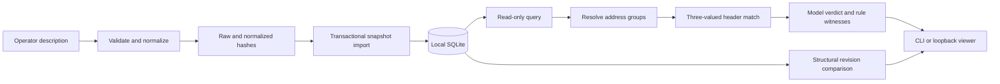

This session builds a testable subset of P7 for S13–S17 and S44. The [runbook](/deployment/policy-workbench) gives commands; this page explains the source. Source line references below identify the implementation in this milestone. Comments, imports and neighboring assignments sometimes share an explanation because they establish one invariant. Update references when editing these files.

No particular Python spelling, database product or UI layout is universally mandatory. The mandatory properties are preserving modeled semantics, exposing uncertainty, maintaining provenance, avoiding partial imports and preventing this read-only path from changing a firewall. SQLite, the small HTTP server and JSON are implementation choices that make those properties reviewable on a thin client.

## Read the process in this order

There is intentionally no arrow from this workbench to a firewall write API. The operational observation path remains the separate home collector. SQLite queries/imports do not run on the Ryu hub or capture thread. This separation keeps a policy import or expensive query from stalling packet ingestion or eventlet OpenFlow work.

## The model: Controller/firewall_policy.py

### Imports and limits, lines 1–22

dataclass stores a small immutable expansion result. datetime normalizes source time to UTC. hashlib identifies byte content. ipaddress supplies tested IPv4/IPv6 containment and strict network parsing. json handles interchange; Path reads an explicitly selected local file; re validates small bounded identifiers. None of these imports opens a network connection.

FORMAT versions the operator-description semantics. MAX_INPUT_BYTES, MAX_RULES, MAX_OBJECTS, MAX_EXPANSION and MAX_EXPANSION_WORK bound admitted work. They are prototype budgets, not measured capacity. IDENTIFIER prevents arbitrary-shaped names from entering identifiers and future references. Changing normalization semantics requires a format/version migration rather than silently reinterpreting old snapshots.

### Input and normalization helpers

| Source lines | What the statements do | Why they exist |
| --- | --- | --- |
| 25–28 canonical_bytes | Serialize sorted JSON keys, compact separators, UTF-8 and finite values. | The same normalized content must produce identical bytes; representation noise should not create arbitrary IDs. This is not source authentication. |
| 31–32 sha256 | Hash supplied bytes. | Separate stable raw-export and normalized-snapshot identities. A filename is insufficient evidence of revision. |
| 35–41 _unique_pairs | Accumulate JSON fields and reject a repeated name before assigning it. | Default JSON parsing can retain the last duplicate field; a security selector must not depend on that ambiguity. |
| 44–52 parse_json | Reject oversized input, duplicate fields, non-finite literals, encoding errors and excessive JSON nesting. | Put a hard boundary before semantic processing. Invalid input becomes an error, never an allow rule. |
| 55–58 read_input | Read at most the byte limit plus one, parse and normalize. | The extra byte detects oversize input without reading an unbounded export. Return raw evidence separately from normalized content. |
| 61–63 _fields | Require exactly the allowed field names on an object. | A native source-zone or application field cannot disappear because the importer ignored an unknown key. |
| 66–71 _text | Check type, length, required/nonempty values and control characters. | Keep metadata bounded and readable; do not execute comments or silently truncate evidence. |
| 74–77 _id | Require the identifier pattern. | Stable bounded IDs support references and SQL lookups. Identifiers are not filesystem paths. |
| 80–83 _conditions | Validate and deduplicate explicit unmodeled-condition descriptions. | Keep unsupported semantics visible and bound their cost. A description is not an implemented predicate. |
| 86–100 _addresses | Accept literal networks/hosts, any and @object references; canonicalize and deduplicate. | Strict network parsing rejects accidental broadening such as a host address with /24. No DNS resolution or external lookup occurs. |
| 103–126 port_intervals | Validate integers/ranges, reject bools and invalid bounds, sort and merge overlaps/adjacency. | A transport port denotes an exact set; 80–90 plus 91 has the same modeled set as 80–91. Python bool is an int subclass, so type must be checked deliberately. |
| 129–133 _ports | Serialize canonical port intervals and recognize a universal range. | Store an idempotent representation that can be validated again when read. |

### Address resolution, lines 136–184

ResolvedAddresses contains a tuple of networks and an unresolved flag. Freezing the dataclass prevents ordinary accidental mutation; it is not a cryptographic security boundary.

AddressResolver.__init__ retains object definitions, a completed-expansion cache and a work counter. _consume increments work and fails above the budget. resolve uses a recursion stack and a network set:

| Source lines | Operation | Failure the operation prevents |
| --- | --- | --- |
| 154–159 | Start an expansion; translate any into both IP-family universes and count work. | Treating any as only IPv4 or allowing unbounded expansion. |
| 160–162 | Parse a literal network and count it. | Mixing raw text with actual address containment. |
| 163–170 | Extract the referenced ID, reject a cycle, bound recursion and require the object. | Infinite recursion and silent missing-object interpretation. |
| 171–177 | Resolve uncached address/group content recursively; preserve unresolved objects as unknown. | Replacing dynamic/native objects with ANY or an empty proven-safe set. |
| 178–181 | Merge completed results, propagate uncertainty and count expanded entries. | Hidden missingness or unlimited repeated expansion cost. |
| 182–184 | Check expanded cardinality and return deterministic order. | Resource overflow and nondeterministic snapshot behavior. |

The exact line grouping above follows the current resolver. A known literal matching the query can establish membership in a union even if another member is unknown. If no known member matches and a member is unresolved, membership is unknown. Unknown does not mean false.

### normalize, lines 187–253

This is the trust boundary between operator input and the supported model. Read it as successive proof obligations:

| Stage | Statements and rationale |
| --- | --- |
| Root shape/source | _fields checks the complete contract. format/source_kind restrict this release to the operator-description format. A native vendor JSON cannot pass simply because its fields look familiar. |
| Identity and time | Validate tenant/site/device/context/vendor IDs, revision text and an aware collected_at time. Convert time to UTC. These are descriptive context, not authenticated tenant permissions or authoritative firewall revision evidence. |
| Default/context | Require an explicit default action and keep unmodeled_context. The engine cannot guess a vendor's implicit default or NAT/application lookup semantics. |
| Objects | Bound object count; distinguish address, address_group and unresolved forms; validate all definitions. Even an unused cyclic object is rejected so an import cannot hide a later trap. |
| Rules | Bound rule count and require every field. IDs and positions are unique; enabled/logging have explicit types; protocol/action must be supported. |
| Selectors and metadata | Canonicalize source/destination/port selectors, keep constraints, comment and owner, and resolve referenced objects. Logging and owner are retained but are not header predicates. |
| Protocol consistency | Only TCP/UDP can carry port constraints. Unsupported combinations fail rather than becoming a broad match. |
| Order/return | Sort by explicit position and return the canonical policy. Position is semantic; input-array order is not an alternative precedence mechanism. |

Normalizing twice must produce identical bytes. The test verifies that property. It does not prove an operator's description accurately represents a physical firewall.

### Concrete queries and three-valued matching

query, lines 256–272, parses concrete endpoints, checks address-family/protocol consistency, validates ports and requires a TCP/UDP destination port. NAT64 is not implemented, so mixed-family queries are refused. An optional unknown source port is represented as None and can make a source-port-constrained rule uncertain.

_address_match, lines 275–278, returns True for known membership, None for unresolved possible membership and False for known exclusion. _port_match, lines 281–286, returns True for any, None for a missing constrained port or an exact interval-membership result.

PolicyEvaluator.match, lines 294–304, combines protocol, source, destination and ports as conjunctions. A known-false predicate yields NO_MATCH. Otherwise any unknown predicate or rule constraint yields POSSIBLE. Only completely known matching predicates with no unsupported constraints yield MATCH. This is a supported header model, not packet/session/application reachability.

### Ordered evaluation: search, lines 306–336

| Source operation | Why it is necessary |
| --- | --- |
| Validate result limit and query; create a fresh resolver. | CLI, HTTP and Python callers get the same contract and a per-query work budget. |
| Iterate the complete ordered rule list. | Pagination must not cause a later decisive rule to be skipped. |
| Omit disabled rules unless requested for display. | Search visibility and effective participation are separate concepts. |
| Skip NO_MATCH; count remaining candidates; retain up to limit rows. | Bound display size while reporting full candidate count and truncation. |
| Before a decisive enabled rule, record POSSIBLE predecessors. | Their actual match/action could change the first effective rule. A later rule cannot erase uncertainty. |
| Record the first enabled MATCH as decisive. | Preserve the declared first-match model. Later rules remain searchable but cannot override it. |
| Use INDETERMINATE if a predecessor or global context is unresolved. | Avoid a false definitive permission/denial. Even matching actions may have unmodeled effects; this first slice stays conservative. |
| Otherwise choose the decisive action or explicit default. | Distinguish a real modeled rule witness from default behavior. |
| Return NOT_EVALUATED/NOT_ATTEMPTED for reachability/enforcement. | A correct model result does not demonstrate routing, NAT resolution or an installed firewall action. |

The 8443 fixture makes this concrete: application-8443 is POSSIBLE before deny-8443, so V1 is INDETERMINATE. In V2 an earlier fully known allow-web matches 8443, so its header-model result is ALLOW. Neither query sends traffic or approves the policy broadening.

### Revision comparison: lines 339–357

diff_policies first requires the same policy identity/context. Its local changed helper compares rule/object maps by stable ID, enumerates additions/removals and returns changed fields with before/after values. It also reports default/context changes and revisions. Actor attribution stays UNAVAILABLE because a file import does not establish who changed a firewall. This structural diff is not a safe-optimization proof or an out-of-band change detector.

## Persistence: Controller/policy_store.py

### Schema and opening a store, lines 1–71

DDL defines snapshots, raw_exports and imports. Snapshot identity hashes canonical content; raw export identity hashes original bytes. imports is an append-only observation ledger, so reimporting the same snapshot preserves another collection event. The scope index makes future context queries practical. Foreign keys keep ledger references valid.

PolicyStore.__init__ has separate writable and read-only paths. Only explicit import opens writable. Exclusive file creation avoids replacing an existing path. New Unix directories/files request private modes. mode=ro refuses a missing database and prevents database writes; query_only adds an explicit read connection boundary. user_version and required-table queries reject unrelated/incompatible databases. Exceptions close the connection. No migration is performed implicitly.

__enter__ and __exit__, lines 73–77, implement the store's explicit lifetime. __exit__ closes SQLite. Python's connection context manager handles commit/rollback but does not itself close the connection; tests use contextlib.closing where they access raw SQLite directly. [Python sqlite3 lifecycle](https://docs.python.org/3/library/sqlite3.html)

### import_snapshot, lines 79–110

| Statements | Required property |
| --- | --- |
| Check writable, parse/normalize the raw bytes again and compare canonical content. | Callers cannot attach raw file A as provenance for unrelated normalized policy B. |
| Compute normalized/raw hashes and import time. | Preserve content identity separately from observation time. |
| Enter the connection transaction and issue BEGIN IMMEDIATE. | Serialize the existence check and writes; two importers cannot independently decide the same revision is new. Busy failures are explicit. |
| Check the conservative store budget inside the serialized operation. | Bound pilot storage and avoid a stale pre-lock budget decision. Journal/filesystem overhead still exists. |
| Compare existing snapshot/raw bodies with their expected content. | Do not silently reuse corrupted evidence under an existing hash key. |
| Insert missing raw export and snapshot, then append the import ledger entry. | Repeated snapshots deduplicate content while retaining observations. Foreign-key failures cannot leave a half-import. |
| Leave the transaction context and return identities/created state. | Successful operations commit together; exceptions roll back all writes. Returned IDs establish stored description identity, not device enforcement. |

SQLite is a convenient local transaction engine for this milestone. The atomicity requirement would still apply if the product later used another database. BEGIN IMMEDIATE obtains the write transaction before the check-and-insert sequence; another writer may receive a busy error rather than silently interleave. [SQLite transactions](https://sqlite.org/lang_transaction.html)

### Read operations, lines 112–143

list_snapshots validates a bounded limit, selects metadata in deterministic order and reports the full count/truncation. Its SQL field names are a fixed program constant; user values use parameter binding.

get_snapshot validates a SHA-256-shaped ID, uses a parameterized lookup, checks stored normalized bytes against the ID and normalizes again before returning. A corrupted body fails visibly. The schema/normalizer version must change if future semantics change; old data must not silently acquire new meaning.

provenance retrieves at most 20 latest import records, checks each returned raw body against its recorded hash and reports the total/truncation. This bounds raw-hash verification work. These are local integrity checks without source signatures; they cannot authenticate an operator, prove actual firewall configuration or protect against a party able to rewrite all local evidence.

## UI and HTTP: Controller/policy_http.py

| Source lines | Component and rationale |
| --- | --- |
| 1–51 | Imports and fixed PAGE HTML/CSS/JavaScript. The viewer is operator convenience; it uses no CDN or frontend build. It explicitly labels the model limits. |
| 21–50 inside PAGE | Snapshot selector, header query, diff form and supported-subset audit button. URLSearchParams encodes inputs; DOM textContent displays data without treating policy comments as HTML. This UI never calls an import/write endpoint. |
| 55–61 | _arguments rejects unknown/repeated query parameters and missing required values. Different interpretations of duplicate parameters must not affect a security query. |
| 64–110 | read_policy_api routes status/list/show/search/diff/audit/impact/preview. It converts query numbers, validates boolean choices and delegates semantics to the shared model/store. HTTP cannot invent an alternative matching algorithm. |
| 114–137 | do_GET parses a bounded query, serves the fixed page or documentation and creates a read-only SQLite connection per request. This avoids sharing a connection across HTTP threads. Errors become explicit 400/404/503 responses. |
| 139–140 | json_response serializes finite JSON. Invalid Infinity-style values must not break a browser or masquerade as valid output. |
| 142–150 | respond sends type/length, disables caching and sets nosniff/CSP headers before writing bytes. These headers help keep a local viewer's data and execution context predictable. |
| 152–153 | Suppress access logs because query URLs can contain private device addresses. Operational errors still need explicit handling/reporting. |
| 156–161 | make_server validates an existing store, binds only 127.0.0.1 and records the store path on the server. It never binds the LAN automatically. |

Local loopback and an SSH tunnel are the current management boundary. Tenant/site labels in a shared database are not authenticated tenant isolation. ThreadingHTTPServer is a prototype serving choice; enterprise authentication, rate control, transport hardening and scale qualification remain P11/P13 work.

## CLI: scripts/policy_inventory.py

Lines 1–11 import standard-library modules and place Controller on the import path relative to this script, so it can run from the repository without installing Ryu or a package. The path comes from __file__, not user text.

main, lines 15–128, declares validate/import/list/show/search/diff/audit/impact/propose/verify-proposal/serve argument contracts. validate parses and reports the content ID without opening a database. import validates before opening a writable store. All remaining data commands use read-only connections. serve validates the port and runs the loopback viewer; Ctrl+C ends it. search builds the same concrete query as HTTP. diff retains before/after snapshot IDs. JSON output is suitable for scripted result capture; controlled errors return nonzero rather than printing a success-shaped result.

Argument parsing, port choice and human-readable indentation are interface choices. Keeping imports explicit, scopes visible, failed operations nonzero and read/write authority separate is necessary for this milestone's claims. The main guard prevents argument parsing or listeners when the module is imported in tests.

## Fixtures, tests and what they prove

examples/policies/reference-v1.json is a sanitized seven-rule/four-object contract fixture. V2 deliberately broadens one earlier rule. The fixture's timestamps/addresses are illustrative source metadata, not observations of your home or a vendor device.

tests/test_policy_workbench.py exercises malformed/ambiguous input, object cycles/missing references, strict CIDRs, port ranges/bools, order/default/disabled/unknown behavior, IPv6/UDP, limit-independent decisions, structural diffs, repeat import, raw/normalized corruption, forced transactional rollback, read-only/missing/unrelated stores and real CLI/HTTP requests. A POST is rejected and HTTP reads leave the database bytes unchanged. Native vendor correctness and t530 resource performance are not established by these fixtures.

To understand the critical boundary, trace one query through CLI/HTTP, query, PolicyEvaluator.search, match, AddressResolver and _port_match. Identify which missing value changes MATCH to POSSIBLE and why that prevents a definitive later result. Then inspect the forced-import-failure test and explain why no snapshot or raw row remains. Those two traces connect the code directly to semantic correctness and durable evidence.

The first P8 audit uses the same read-only snapshot boundary. See [its source rationale](/developers/qualification-code-tour) and [witness-based audit runbook](/deployment/policy-audit) for the bounded symbolic algorithm, uncertainty and native-policy limits.

The current change-impact/preview controls and CLI receipt workflow are explained in [the dedicated source tour](/developers/policy-change-code-tour). Their candidates are hypothetical, stores remain read-only and native equivalence is unassessed.
