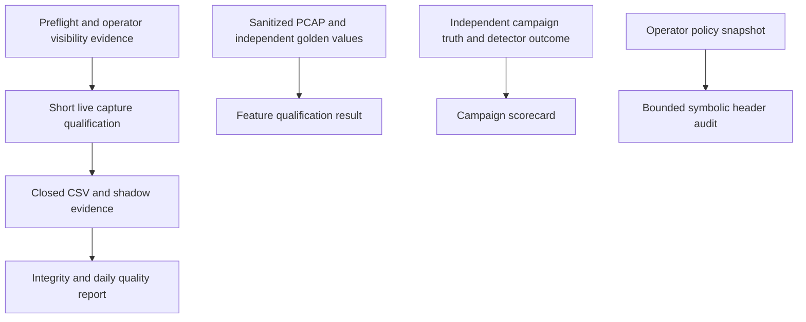

This milestone implements the six preparations in [the qualification runbook](/deployment/pretest-qualification). It advances evidence for P1/P2/P3/P6 and the first P8 audit subset. The paths remain separate from Ryu's hub, live model training and firewall writes. Read this page with the source: line ranges identify related assignments/branches in this revision, while function names remain the stable anchors. Tests establish the stated fixture invariants; they do not establish production readiness.

## Processing paths

None of these arrows approves traffic as benign or sends a firewall action. Qualifying the observer, measuring a detector and proving a model-rule relation answer different questions.

## Shared lease and collector changes

Controller/collection_io.py, collection_lease at lines 9–31, owns an OS-managed exclusive nonblocking file lock. POSIX flock and Windows byte-range locking implement the same single-owner rule. Closing the file releases the lock even after process exit; deleting a lock file to bypass another process would break that invariant. create false lets preflight inspect an existing lock without creating one. A new/missing lock is only point-in-time evidence, because a writer may start after preflight returns. Report/reviewer/writer use the shared primitive; it is not a distributed lock or a defense against an administrator ignoring it.

Controller/home_sensor.py now constructs the 71-column contract in collection_contract instead of duplicating its definition. Preflight imports this pure function so it cannot accidentally initialize a collector and create state merely to compare settings. Names/order/network/parser/cap settings remain byte-equivalent to the previous contract. Each run manifest adds code hashes, Python/Scapy and OS/kernel versions, separate from the unchanged collection REST/CSV schemas. Reproducibility requires those versions; a hash alone does not authenticate code.

The restart loader checks profile structure, unique bounded peer lists, nonnegative integer window counts, finite TTL means in the protocol range, parseable addresses and membership of saved device IPs in configured networks. A corrupted checkpoint fails instead of contaminating future novelty/TTL features. Rolling buckets still restart; these checks do not invent missing history. The main collector keeps the lease for its lifetime. The baseline review wrapper translates a conflicting lease into its existing stop-first error, using the same shared primitive.

## Preflight: scripts/home_preflight.py

| Source anchor | What each group of statements does and why |
| --- | --- |
| Imports and ROOT | Standard-library checks plus a repository-relative Controller import path. The path is based on __file__, not user shell text. Scapy-dependent runtime imports are delayed so missing dependencies can become a structured failure. |
| visibility, lines 21–55 | Requires exact visibility-v1 fields, matching interface/ordered networks, offset-aware valid dates, reviewer and bounded path records. Direction flags must be booleans, both true, with an evidence reference. At least one path per configured IP family is required. This is deliberately weaker than claiming every device/path is tested; the operator must supply that coverage. |
| preflight, lines 58–151 | Adds named PASS/FAIL/REVIEW checks rather than a misleading single success print. Python/imports, finite budgets, existing ancestor disk/access and loopback port are checked first. No data directory or test payload file is created. |
| Live branch inside preflight | Requires Linux AF_PACKET, looks up an existing interface/state, opens/closes a raw socket and queries timedatectl with a bounded timeout. Root/CAP_NET_RAW is tested, but no capture/mirror/firewall is configured. NTP's assertion is not an independent clock-accuracy measurement. |
| Replay branch | Opens only the first PCAP record to detect basic input failure. It marks live qualification REVIEW; a replay cannot measure a physical mirror's losses. Full correctness belongs to golden/replay tests. |
| Contract/policy branch | Uses the shared contract and ShadowPolicy validation, checks approved schema/device network membership and source fingerprints, then checks schema under an existing lease. Changed settings fail and request a new directory. A saved profile remains a review item; runtime performs detailed restoration validation. |
| main, lines 154–175 | Defines the same relevant interface/network/parser/policy/budget arguments, renders finite JSON and returns 0/1/2. Controlled configuration/import errors produce FAIL. No route grants response authority. |

The choice of JSON, flag names and a four-second command timeout is an implementation choice. Essential properties are no network configuration changes, explicit uncertainty, finite/bounded inputs and exact runtime-contract comparison. Never replace actual transaction evidence with an --assume-mirror shortcut.

## Independent golden extraction

scripts/qualify_home_collection.py has four building blocks. hello (24–33) builds known TLS bytes without calling the TLS parser. fixtures (36–63) constructs deterministic Ethernet/VLAN/IP/transport packets with explicit event timestamps and a closing out-of-scope ARP event to flush full windows. qualify (66–106) writes PCAPs, invokes the actual collection ingest/window path, reads resulting CSVs and compares against the committed hand-derived JSON. main (109–115) requires a fresh output directory and reports failure via exit status.

All 58 feature columns are represented in the core expected rows, including meaningful null values. The checker verifies that the expected names cover the complete runtime feature list. It uses tight numerical tolerance for floating point, not exact decimal string equality. Additional nonzero DNS/TLS/HTTP, fragment and IPv6 fixtures prevent all-zero parser features from masquerading as coverage. Labels must stay UNKNOWN and completed fixture windows must be marked complete. tests/fixtures/site-v3-golden.json retains derivations independently of extraction. Updating it solely to match failing actual output would destroy the oracle: review packet lengths/math first.

The PCAP reader/event-time ingest is real; the Linux socket path is not exercised by this tool. Full reassembly, encrypted payloads, arbitrary DNS/TLS/HTTP variants and rate-dependent losses remain unqualified. Existing parser opt-in, malformed/incomplete input and bounded-cardinality tests complement these fixtures.

## Runtime exercise and failure tests

scripts/qualify_home_runtime.py, exercise (19–68), bounds window/device arguments, allocates a new artifact directory and emits a controlled source population into the real aggregator. It flushes complete windows, closes/checkpoints halfway, reconstructs HomeCollection from the saved profile, then checks every row's counts/rates/novelty/UNKNOWN label. The report also checks closed-file integrity and expected total rows. Its accelerated event time is explicitly distinguished from elapsed wall time. Optional process RSS is sampled rather than claimed as true peak; retained profile/artifact sizes remain visible. main (71–79) exposes those limits and a nonzero failure status.

tests/test_collection_readiness.py adds independent checks for atomic replacement failure, old checkpoint preservation, invalid profile restoration, invalid timestamps, subprocess lease conflict/crash release, active-writer report refusal, missing evidence, evidence tampering, nonfinite non-prefixed features, low-disk refusal, idle gaps and preflight side effects. Tests use temporary files/processes; they never fill your real disk or kill your running collector. Actual Ubuntu power loss, service permissions and sustained AF_PACKET load still need hardware evidence.

## Closed quality report: Controller/collection_report.py

| Component | Invariant and reason |
| --- | --- |
| QUALITY_COUNTERS / TEXT_FIELDS | Enumerate faults and distinguish provenance text from numeric columns. Every other present numeric value is checked for finiteness, including packet-size fields that lack a g prefix. Missing optional values stay null. |
| instant | Reject naive timestamps rather than silently interpreting host-local time as UTC. |
| report | Acquire the writer's lease for the entire scan. No report on a changing file set is labeled consistent. The helper may create only the lease file. |
| _report setup | Read/hash the schema, allocate counters and create a temporary SQLite interval index. Disk-backed indexing keeps cross-run duplicate/overlap checks from requiring millions of in-memory keys. |
| CSV/evidence loop | Pair rows and evidence lines with zip_longest, requiring equal lengths and complete evidence lines. Check header/provenance/date-run filename/window bounds/flags, parser settings, nonnegative basic counters and rate equations. Recompute evidence hashes, compare shared identity/time/schema and mirrored profile features. A torn CSV/JSONL pair fails. |
| Interval index and aggregation | Admit bounded devices/rows, detect cross-file duplicate/overlapping intervals, then summarize daily/device counts and parser observations. A second ordered pass measures gaps; gaps are not automatically packet loss. |
| Run manifest reconciliation | Compare row totals/schema hashes and identify missing/orphan records. Aggregate loss/cap/parser faults and final states. Unclosed, replay, unversioned and unmeasured-kernel runs require review. Include source/environment fingerprints and captured/unsupported totals. |
| Final status | FAIL for integrity issues; REVIEW for quality/partial/held evidence; PASS only for the listed checks. No baseline promotion, benign label or detector confidence follows. |

scripts/audit_home_data.py retains the existing audit(directory) entry point and positional directory CLI, adds a new-output-only JSON option outside the collection directory and exposes the richer status. Its 0/1/2 exit contract now includes review of partial/held/replay/unclosed/unversioned runs. Old files without runtime fingerprints remain readable but require review. The report's two-million-row/4,096-device bounds abort rather than publish an incomplete certified result. Existing incomplete archives may now fail stronger evidence checks; investigate instead of rewriting them to make a check pass.

## Campaign scorecard: scripts/evaluate_security_campaign.py

timestamp (21–25) parses offset-aware event times. score (28–114) validates exact record fields, supported scenario/truth/verdict values, bounded identifiers, actual booleans, unique IDs, one frozen detector revision, nonoverlapping per-subject campaign intervals and ordered in-interval event times. Arrival/coverage/quality and independent truth are separate evidence gates. Unknown/unqualified records are counted and excluded, not treated as true negatives.

The classification branch deliberately counts malicious abstentions as misses, while keeping benign abstentions separate from TN. Precision/recall and false-alert-per-qualified-benign-window denominators are explicit; absent denominators yield null. Independent containment counts require traffic_block_verified_at rather than a printed action or read-back alone. Latencies retain stage-specific sample sizes and median/p95/max; no probability calibration or independence claim is inferred. main (117–135) bounds file size, records its SHA-256 and refuses overwriting a report. The template returns no qualified evidence until the operator supplies actual observations.

Text references are operator-provided provenance, not authenticated ground truth. Supporting logs/captures and experiment review remain necessary. The evaluator intentionally has no traffic-generation, model-training or enforcement import. These boundaries keep evaluation artifacts from silently changing the system under test.

## Symbolic policy audit: Controller/policy_audit.py

| Source lines | Function and rationale |
| --- | --- |
| 10–22 | AuditBudgetError and Budget.tick enforce bounded work. An interrupted/capped proof must fail, not return a complete-looking partial result. |
| 26–35 | Box stores family/protocol plus four inclusive address/port intervals. witness turns the first coordinate into a concrete tuple that can be inspected. IPv6 uses IPv6Address explicitly, avoiding accidental IPv4 rendering for low integer values. |
| 38–43 | intersection rejects different family/protocol cases and intersects every dimension conjunctively. Sharing just one port/address is insufficient for a full region match. |
| 46–61 | subtract partitions one rectangle around an overlap into disjoint remainder pieces, dimension by dimension. It preserves the region outside the earlier rule, including source-port constraints. |
| 64–72 | difference repeatedly subtracts cuts and stops when no residual remains. A union of several earlier rules can therefore prove coverage; a 4,096-residual cap prevents combinatorial growth. |
| 75–94 | regions resolves static address sets, collapses equivalent networks, enumerates valid IPv4/IPv6 TCP/UDP/ICMP cases and forms bounded products with port intervals. Unsupported conditions/objects return unknown. ANY is explicitly limited to this assessment domain. |
| 97–184 | audit_policy validates the model, enforces rule/work/finding limits, records metadata findings, computes effective predecessor coverage and emits duplicate/shadow/redundant/partial findings. Remaining witnesses are only asserted to reach the rule if no unknown predecessor exists. Object reference traversal includes disabled rules/nested groups, but cannot see native NAT/VPN/application references. |

First-match behavior matters: if rule A already covers a region, a later unreachable deny B cannot make a duplicate allow C appear to change effective behavior. Conversely, different effective action or logging prevents a REDUNDANT_BEHAVIOR assertion. Unknown logging is not equal proven logging. Fully known coverage can prove a rule unreachable even if other earlier unknown rules might also intercept it; it cannot prove equivalent behavior through an unknown predecessor.

Object duplicates compare resolved static sets, not names. UNREFERENCED_OBJECT_IN_MODEL is deliberately narrower than unused native object. The report disables automatic_cleanup and retains reachability NOT_EVALUATED/enforcement NOT_ATTEMPTED. Extending this algorithm to schedules/users/applications/profiles requires representing those dimensions and qualifying their semantics; dropping them would make the proof unsound.

## API/UI/CLI wiring and qualification

scripts/policy_inventory.py adds an audit subcommand with a read-only PolicyStore. Controller/policy_http.py adds GET /policy/audit with strict single snapshot parameter validation and the existing bounded/read-only/error flow. The viewer button uses URLSearchParams and textContent. It never submits an apply/delete request. docs-site/policy-openapi.json records the new route, caps and scope; the Ryu API remains a separate service.

tests/test_policy_audit.py uses an independently written finite-space matcher to compare shadow/equivalence claims across 40 seeded eight-rule policies. It also tests union coverage, action/logging differences, unknown/global conditions, disabled rules, IPv6/source ports, object scope and budget errors. Real CLI/HTTP operations must leave database bytes unchanged. tests/test_security_campaign.py checks exclusions, abstentions, denominators, distinct read-back/traffic verification and rejected invalid/mixed evidence.

JSON, SQLite, CLI formatting and UI placement are replaceable implementation choices. Essential invariants are faithful declared scope, preserved unknowns, independent expected results, bounded resource use, source/evidence lineage, explicit action authority and checked outcomes. Passing these tests permits the documented next hardware/lab tests; it does not establish universal firewall compatibility or a guarantee against missed attacks.
